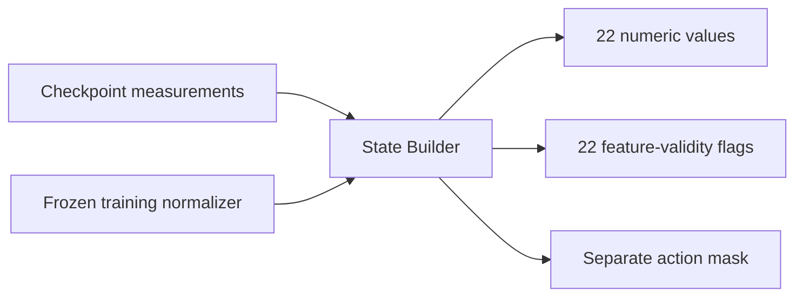

# State Builder

Status: implemented and verified offline in TASK-004. The observation contract is
ready for integration; live routing and assessment producers remain separate work.

The State Builder converts checkpoint measurements into a fixed numeric input for
a future router. It preserves the difference between a valid zero and an unknown
measurement and applies the same frozen transformations during training and runtime.
It does not choose a model or train the actor/critic.



## Code and interfaces

Implementation: [src/hecate/telemetry/state.py](../../src/hecate/telemetry/state.py).
Configuration: [routing_observation.yaml](../../configs/routing_observation.yaml).
It lives beside the collector to avoid importing router training/backbone
infrastructure during offline replay.

```python
builder = StateBuilder(config)                # raw diagnostic mode
observation = builder.build(checkpoint)
normalizer = builder.fit(checkpoints, split_manifest)
frozen = StateBuilder(config, normalizer)
observation = frozen.build(checkpoint)         # normalized diagnostic mode
observation = frozen.build(checkpoint, router_ready=True)
```

`save_normalizer(path, artifact)` writes a new file without overwriting an existing
one. Constructor validation checks schema/feature order and normalizer hashes.

## Inputs

A raw observation from the [Telemetry Collector](telemetry-collector.md) contains
checkpoint identity, the 22 named measurements and optional controller action
availability. A normalization artifact is required for router-ready output.

The fixed v1 feature order is:

```text
 0 completed_interactions       11 visible_failed
 1 model_requests               12 visible_pass_delta
 2 transport_attempts           13 input_tokens
 3 advisor_calls                14 output_tokens
 4 request_budget_used          15 inference_s
 5 elapsed_s                    16 context_used
 6 time_budget_used             17 active_model_m2
 7 command_failure_rate         18 advisor_progress
 8 command_timeouts             19 advisor_stuckness
 9 repeated_errors              20 advisor_remaining_difficulty
10 visible_passed               21 advisor_confidence
```

The [task definition](../tasks/e7-telemetry-and-routing-state-builder.md#concrete-schemas--v1)
contains the full typed schemas, units and example. Feature order is configuration,
not incidental dictionary ordering. Schema v1 rejects a different order.

## Normalization and missingness

For a valid continuous feature:

```text
z_i = (x_i - mean_i) / max(std_i, epsilon)
```

The default epsilon is `0.000001`; no automatic clipping is applied. Statistics use
population standard deviation. Counts and fractions are standardized by the same
formula; binary `active_model_m2` passes through unchanged.

- Unknown or nonfinite values become numeric zero and a false validity flag.
- A genuine zero remains valid and receives the configured transformation.
- A feature with no valid fitting observations stays disabled/masked.
- A constant feature uses epsilon instead of dividing by zero.
- The raw named measurements are retained separately from the transformed vector.

For standardized features, zero-filled missing values are equivalent to imputing
the training mean before normalization. A router must consume validity flags;
the numeric value alone cannot distinguish missing from observed zero.

## Training-only fitting

The split manifest explicitly lists `training_ids` and `reserved_ids`. Fitting
requires nonempty observations, nonempty training IDs, disjoint sets, every fitting
task in the designated training set, and each observation marked `split = train`.
Validation, reserved evaluation and pilot-only observations cannot fit statistics.

The artifact records:

```text
version, schema_hash, features,
stats[feature] = {mean, std, count},
fitting_task_ids, fitting_observations_hash, split_manifest_hash, hash
```

Its hash covers the artifact excluding the `hash` field. Loading rejects a changed
artifact, schema or feature order. Fit once on the intended training observations;
reuse that artifact for evaluation/runtime without refitting.

The sample TASK-004 normalizer uses two training observations to demonstrate the
contract. It is not a selected or adequately estimated production normalizer.

## Output and readiness modes

Every output includes checkpoint/source identity, raw `features`, schema version
and hash, `feature_order`, `vector`, `validity_mask`, `action_mask`, optional
`normalizer_hash` and `mode`.

`vector` and `validity_mask` each have exactly 22 entries. The action mask is a
separate `[stay_allowed, escalate_allowed]` pair. A null action mask means historical
controller availability was not recorded; it does not mean both actions are allowed.

Three modes are explicit:

- `raw_diagnostic`: finite raw values, with missing entries zero-filled and masked.
- `normalized_diagnostic`: frozen normalization applied, without a claim of live
  routing integration.
- `router_ready`: additionally requires a frozen normalizer, known active model
  and explicit valid controller action availability.

A router-ready record does not mean a PPO policy has been trained or deployed.
The actor consumes the observation; the critic is a separate training component.

## Replay and frozen reload

From the repository root, after restoring the saved training/pilot traces:

```bash
PYTHONPATH=src python scripts/replay_routing_observations.py \
  --inputs configs/telemetry/task004_replay_inputs.json \
  --output-root data/outputs/runs --run-id state-fit-example-01 \
  --fit-split configs/telemetry/task004_normalization_split.json
```

To reuse the artifact, choose a new run ID and pass:

```bash
--normalizer data/outputs/runs/state-fit-example-01/normalizer.json
```

`--fit-split` and `--normalizer` are mutually exclusive. Add `--router-ready` only
when the input contains explicit controller masks and model context. Existing
historical traces intentionally remain diagnostic because action masks are absent.

See the [replay runbook](../tasks/task-004-reuse-and-runbook.md) for full commands,
source provenance and artifact verification.

## Verification and limits

Tests cover missing versus zero, constant/all-missing features, reserved-ID
exclusion, frozen-hash reload, feature order, advisor freshness, controller gating,
causal checkpoint collection and evaluator exclusion. Fitted and frozen-reload
real-trace replay produced byte-identical observation JSONL. TASK-004's combined
telemetry/state and existing compatibility suite passed 45 tests.

The collector only accepts validated structured advisor/test signals; this task
does not establish their quality or implement their live producers. Free-form E7
advice remains audit text. Final correctness, hidden test outcomes, gold patches
and rewards stay outside the observation. Live controller integration, policy
training and production monitoring are subsequent tasks.
